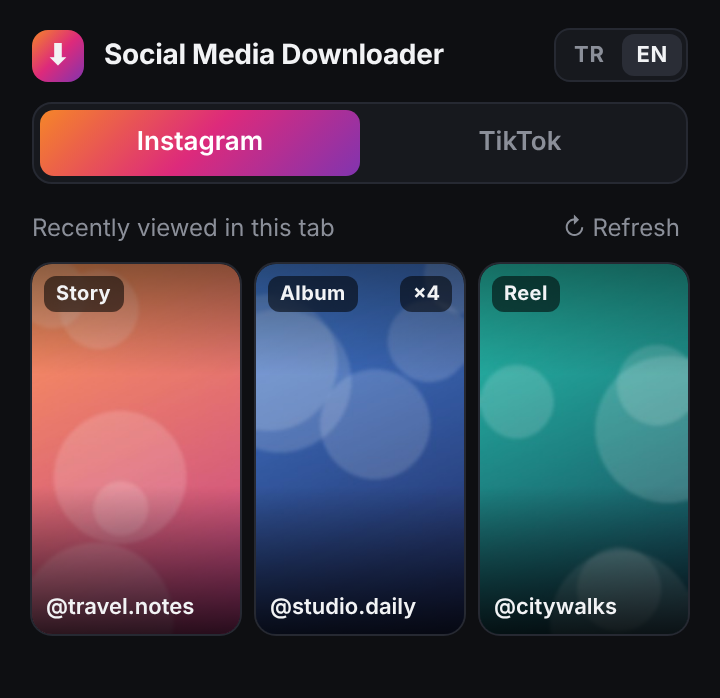

# Social Media Downloader

A lightweight Chrome extension that lets you download the Instagram and TikTok content you've **recently viewed** — stories, posts, reels, albums and videos — with one click.

  

**English** · [Türkçe](#türkçe)

## Features

- **One popup, two platforms:** switch between Instagram and TikTok
- **Your last 3 viewed items** appear with thumbnails, so you can see exactly what you're downloading
- **Instagram:** stories, highlights, feed posts, reels and multi-item albums (every item in an album is saved)
- **TikTok:** videos in the For You feed and on video pages (highest available quality, with audio), plus photo posts
- **No extra network requests:** it only reads data the page has already loaded, so it doesn't hit Instagram or TikTok APIs on its own
- **No server, no tracking, no accounts:** everything runs locally in your browser
- English and Turkish interface

## Installation

1. Download the latest `.zip` from [Releases](../../releases) and extract it (or clone this repo).
2. Open `chrome://extensions` in Chrome.
3. Turn on **Developer mode** (top right).
4. Click **Load unpacked** and select the extracted folder.
5. Pin the extension from the puzzle icon in the toolbar for quick access.

If Instagram or TikTok was already open, reload those tabs once.

## Usage

1. Browse Instagram or TikTok as usual: open a story, scroll your feed, watch a video.
2. Click the extension icon.
3. Pick the platform, then click the thumbnail you want to download.

Files are saved to your Downloads folder as `username_date_id.ext`.

## How it works

Instagram and TikTok send the media URLs to the page as JSON when you browse. The extension listens to those responses (and to the data embedded in the page) inside the page context, keeps track of which item is currently on screen, and downloads the original file directly from the CDN when you click it.

| File | Role |
| --- | --- |
| `core.js` | Shared logic: response capture, recently-viewed list, thumbnails, downloads |
| `ig.js` | Instagram data parsing and on-screen item detection |
| `tt.js` | TikTok data parsing and on-screen item detection |
| `bridge.js` | Connects the popup to the page |
| `popup.html` / `popup.js` | The popup UI |

## Troubleshooting

- **"Tab not ready":** reload the Instagram/TikTok tab.
- **Nothing shows up:** open a piece of content first, then reopen the popup.
- **It stopped working:** Instagram and TikTok change their sites often. Please open an issue and include the browser console output.

## Disclaimer

This project is **not affiliated with, endorsed by, or connected to Meta Platforms, Inc., Instagram, ByteDance or TikTok**. All trademarks belong to their respective owners.

It is intended for **personal use** only, such as saving your own content or content you have permission to keep. Respect creators' rights and the platforms' terms of service. You are responsible for how you use this tool.

## License

[MIT](LICENSE)

---

## Türkçe

Instagram ve TikTok'ta **son görüntülediğin** içerikleri (hikâye, post, reel, albüm, video) tek tıkla indirmeni sağlayan hafif bir Chrome eklentisi.

### Özellikler

- **Tek pencere, iki platform:** Instagram ve TikTok arasında geçiş yap
- **Son görüntülenen 3 içerik** küçük resimleriyle listelenir, ne indirdiğini görürsün
- **Instagram:** hikâyeler, öne çıkanlar, akıştaki postlar, reels ve çoklu albümler (albümdeki her medya kaydedilir)
- **TikTok:** For You akışındaki ve video sayfasındaki videolar (sesli, en yüksek kalite) ve fotoğraf postları
- **Ekstra istek yok:** sadece sayfanın zaten yüklediği veriyi okur
- **Sunucu, takip veya hesap yok:** her şey tarayıcında çalışır
- Türkçe ve İngilizce arayüz

### Kurulum

1. [Releases](../../releases) bölümünden son `.zip` dosyasını indirip aç (ya da repoyu klonla).
2. Chrome'da `chrome://extensions` adresine git.
3. Sağ üstten **Geliştirici modu**nu aç.
4. **Paketlenmemiş öğe yükle**'ye bas ve açtığın klasörü seç.
5. Kolay erişim için araç çubuğundaki yapboz ikonundan eklentiyi sabitle.

Instagram veya TikTok zaten açıksa o sekmeleri bir kez yenile.

### Kullanım

1. Instagram veya TikTok'ta normal gez: hikâye aç, akışı kaydır, video izle.
2. Eklenti ikonuna tıkla.
3. Platformu seç ve indirmek istediğin küçük resme tıkla.

Dosyalar İndirilenler klasörüne `kullanıcı_tarih_id.uzantı` adıyla kaydedilir.

### Sorun giderme

- **"Sekme hazır değil":** Instagram/TikTok sekmesini yenile.
- **Hiçbir şey görünmüyor:** önce bir içerik aç, sonra eklentiyi tekrar aç.
- **Çalışmayı bıraktı:** Instagram ve TikTok sitelerini sık değiştirir. Tarayıcı konsolundaki çıktıyla birlikte bir issue aç.

### Sorumluluk reddi

Bu proje **Meta Platforms, Inc., Instagram, ByteDance veya TikTok ile bağlantılı değildir** ve bu şirketler tarafından desteklenmez. Tüm markalar sahiplerine aittir.

Yalnızca **kişisel kullanım** içindir: kendi içeriğini ya da saklama iznin olan içerikleri kaydetmek gibi. İçerik üreticilerinin haklarına ve platformların kullanım şartlarına saygı göster. Aracı nasıl kullandığından sen sorumlusun.
